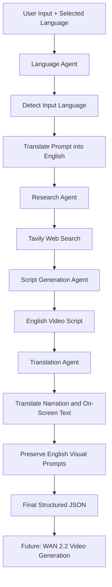

# 🌍 Multilingual AI Video Agent

An AI-powered multilingual educational video scripting system that transforms user prompts in different languages into researched, structured, and translated video scripts.

The system uses a multi-agent architecture built with **LangGraph, Python, OpenRouter, and Tavily** to understand user requests, research topics, generate educational scripts, and translate narration into the user's preferred language.

---

## 🚀 Project Overview

Creating educational videos for audiences who speak different languages often requires manual research, scriptwriting, and translation.

This project aims to automate that workflow through a collaborative AI agent system.

Users can:
- Enter a video prompt in languages such as English, Hindi, Kannada, and more.
- Select their preferred narration language independently of the input language.
- Automatically research the requested topic.
- Generate an educational video script with structured scenes.
- Translate narration and on-screen text into the selected language.
- Preserve visual generation prompts in English for compatibility with AI video-generation models.

The final output is a structured JSON object that can be used as input for downstream video-generation pipelines.

## ✨ Key Features

- **Multilingual Input:** Accepts prompts in different languages.
- **Language Detection:** Identifies the language of the user's original prompt.
- **Prompt Translation:** Converts the user's request into English for research and script generation.
- **AI-Powered Research:** Retrieves relevant information using Tavily.
- **Automated Script Generation:** Generates structured educational scripts using an LLM.
- **Multilingual Narration:** Translates video narration into the user's selected language.
- **Scene-Based Output:** Organizes scripts into five scenes.
- **Structured JSON:** Produces machine-readable output for future integrations.
- **Unicode Support:** Preserves multilingual characters using UTF-8 encoding.

## 🏗️ System Architecture

The project follows a sequential multi-agent architecture orchestrated using LangGraph.



## 🤖 AI Agents

| Agent | Responsibility | Technology |
|---|---|---|
| Language Agent | Detects input language and translates the prompt into English | Python, LLM, Pydantic |
| Research Agent | Collects relevant information about the requested topic | Tavily API |
| Script Generation Agent | Generates structured educational video scripts | OpenRouter, LLM |
| Translation Agent | Translates narration and on-screen text into the selected language | OpenRouter, Pydantic |
| Workflow Orchestrator | Coordinates agent execution and maintains shared state | LangGraph |

## 🔄 Workflow

1. **User Input:** The user enters a topic in any supported language and selects a narration language.
2. **Language Analysis:** The Language Agent identifies the input language and extracts the topic in English.
3. **Research:** The Research Agent retrieves relevant information using Tavily.
4. **Script Generation:** The Script Agent generates an educational video script in English.
5. **Translation:** The Translation Agent translates the title, narration, and on-screen text into the selected language.
6. **Visual Prompt Preservation:** Visual prompts remain in English for downstream image and video-generation models.
7. **Final Output:** The system produces a structured JSON response containing the original input, selected language, and translated video script.

## 🛠️ Technology Stack

| Category | Technologies |
|---|---|
| Programming Language | Python 3.12 |
| Agent Orchestration | LangGraph |
| LLM Integration | OpenRouter |
| Web Research | Tavily API |
| Data Validation | Pydantic |
| Testing | Pytest |
| Output Format | JSON |
| Version Control | Git, GitHub |

## 📁 Project Structure

```text
multilingual-ai-agent/
│
├── app/
│   ├── agents/
│   │   ├── language_agent.py
│   │   ├── prompt_agent.py
│   │   ├── research_agent.py
│   │   └── scripts_agent.py
│   │
│   ├── graph/
│   │   ├── state.py
│   │   └── workflow.py
│   │
│   ├── models/
│   │   └── schemas.py
│   │
